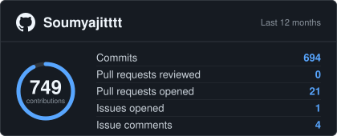

## About Me

I'm Soumyajit, a third-year CSE (AI/ML) student at Heritage Institute of Technology. I build full-stack web apps, contribute to open source, and take part in hackathons alongside my coursework. I was selected for GSSoC 2026 and was a member of GDG on Campus HITK. I share my projects here on GitHub and on LinkedIn.

## Tech I Use

## Open Source & Community

  
  

<table>
  <tr>
    <td>
      
       
      
    </td>
    <td>
      
       
      
    </td>
  </tr>
</table>

## Activity & Stats

| GitHub Activity | LeetCode Stats |
| :---: | :---: |
|  |  |

## Connect With Me

